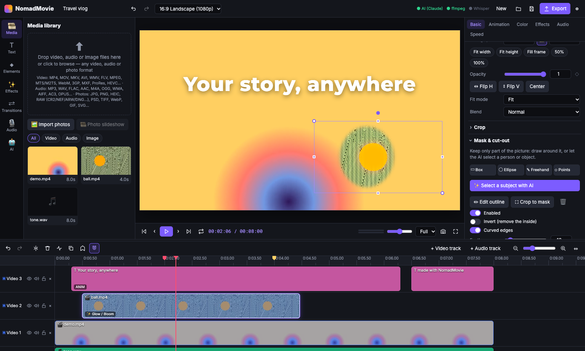

<div align="center">


# NomadMovie

**A free, open-source video editor with AI built in.**
Edit on a multi-track timeline, animate titles like in After Effects, cut people out of a shot with one click,
and let an AI assistant do the tedious parts — with the AI you already use.

[](https://github.com/faridmasjedi/NomadMovie/actions/workflows/ci.yml)
[](https://github.com/faridmasjedi/NomadMovie/releases/latest)
[](LICENSE)

**[⬇ Download for macOS, Windows or Linux](https://github.com/faridmasjedi/NomadMovie/releases/latest)** · **[📖 Website and full guide](https://faridmasjedi.github.io/NomadMovie/)**



</div>

## Why NomadMovie

- **Everything runs on your computer.** Your footage never leaves your machine, and export uses your GPU and is faster than real time.
- **Bring your own AI.** Use your Claude subscription, an API key from Claude, ChatGPT, Gemini or OpenRouter, or a free local model with Ollama. Or use no AI at all: every editing tool works without it.
- **One click to cut someone out.** Click a person or object and NomadMovie outlines it and follows it through the clip. The AI model for this runs locally.
- **Free and open source** under the MIT license.

## Features

Every feature has a step-by-step guide with an animated demo on the **[NomadMovie website](https://faridmasjedi.github.io/NomadMovie/)**.

### Editing
Multi-track video and audio timeline · drag and drop · split, trim, ripple delete · snapping and markers · copy, paste, duplicate · unlimited undo · lock, hide and mute tracks · autosave · project files · any video, audio or photo format (MP4, MOV, MKV, WebM, ProRes, HEVC, HEIC, RAW, PSD…).

### My presets
Set up a clip the way you like (color, effects, animation, size and position, crop, mask, audio, speed or text style), click **Save as preset**, and apply it to any clip later from **★ My presets** in the sidebar. You can apply it to many clips at once, and the AI assistant can use your presets too. Presets work in every project and can be exported to share.

### Motion graphics
Text with style presets and 7 bundled fonts · shapes and gradients · keyframes for position, scale, rotation, opacity and blur with 8 easing curves · 14 in/out animation presets (typewriter, word by word, pop…) · zoom and pan moves · freeze frames · photo slideshows.

### Easy animation
- **Motion presets:** one click to make anything float, sway, wiggle, bounce, pulse, spin, swing like a pendulum, orbit, shake, blink or drift, with no keyframes. Combine them and adjust speed and strength.
- **Animate the parts of an illustration:** import an SVG and click **Split into layers** to put each part (head, arm, wing…) on its own track, ready to animate.
- **Anchor points and parenting:** choose what a part turns around (a shoulder, a stem), and make parts follow each other (hand → arm → body), like in After Effects.
- **Lottie animations:** drop in `.json` animations exported from After Effects or downloaded from [LottieFiles](https://lottiefiles.com). They play and loop on the timeline.
- The AI assistant can do all of this for you: *"split the character into layers and make the arm wave"*.

### Effects and color
90 GPU effects (deep glow, anamorphic flares, film emulation, glitch, VHS, light leaks, weather…) · outlines, drop shadows and neon glows for cut-outs · 155 transitions · effect layers that apply to everything below them · 16 color looks plus manual grading · chroma key · blend modes.

### Masks and cut-outs
Draw a box, ellipse, freehand or point-by-point mask on the preview and keep only what's inside, or invert it. Feather and expand the edge, and animate the mask with keys. On an effect layer, a mask limits the effect to one area, for example to blur a face or brighten a sky.

**✨ Select a subject with AI:** click a person or object and it's outlined for you. **Track** follows it through the whole clip. This uses [EdgeTAM](https://huggingface.co/onnx-community/EdgeTAM-ONNX), a fast version of Meta's Segment Anything 2, running on your GPU. The ~40 MB model downloads once.

### Audio
Volume keyframes and fades · pan · 3-band EQ · noise and hum reduction · voice enhance · compressor, reverb, echo · voice-over recording · automatic silence removal · loudness normalization · auto-duck music under speech · beat detection.

### AI assistant
Describe what you want, such as *"make a 5-second intro with my channel name"*, *"color grade this like a film"* or *"add subtitles"*, and the assistant edits your project. It can also design SVG stickers and graphics, look at the frame to fix color, time a script to the speech for subtitles (with SRT export), and cut on the beat or on scene changes.

### Export
MP4 (H.264), WebM, MOV, GIF, MP3 and WAV · choice of resolution and quality · export only a selected range. Frames are rendered and hardware-encoded directly instead of being played back, so an 8-second 1080p video exports in about 4 seconds even on a 2019 laptop.

## Connect an AI

Open **⚙ Settings → AI assistant** in the app and pick one. Use **Test connection** to check it before saving.

| Option | What you need | Cost |
| --- | --- | --- |
| **Claude subscription** | A Claude Pro or Max plan. Click **Set up** and **Sign in with Claude** in the app: it installs [Claude Code](https://docs.claude.com/en/docs/claude-code) for you and signs in through your browser | Included in your plan |
| **Claude API** | A key from [console.anthropic.com](https://console.anthropic.com/settings/keys) | Pay per use |
| **ChatGPT / OpenAI** | A key from [platform.openai.com](https://platform.openai.com/api-keys) | Pay per use |
| **Google Gemini** | A key from [Google AI Studio](https://aistudio.google.com/apikey) | Free tier available |
| **OpenRouter** | A key from [openrouter.ai](https://openrouter.ai/keys), one key for hundreds of models | Pay per use, some free models |
| **Local AI** | [Ollama](https://ollama.com) or [LM Studio](https://lmstudio.ai) running on your computer | Free and fully private |
| **Other service** | Any OpenAI-compatible address (Groq, Mistral, DeepSeek, Together, your own server…) | Depends on the service |

Keys are saved only on your computer, in a settings file readable only by your user account, and are sent only to the service you pick. The assistant works best with capable models; small local models can handle simple requests.

## Install

Download the installer for your system from the **[latest release](https://github.com/faridmasjedi/NomadMovie/releases/latest)**.

- **macOS:** open the `.dmg` and drag NomadMovie into Applications. Use the `arm64` file for Apple Silicon (M1 and later) and `x64` for Intel Macs. If macOS says it can't check the app, right-click it in Applications and choose **Open**. You only need to do this once.
- **Windows:** run the `setup.exe`. If SmartScreen appears, click **More info → Run anyway**.
- **Linux:** use the `.AppImage` (make it executable and run it) or install the `.deb`.
- **No installer?** Every release also has a plain `.zip` for each system: unzip it and run NomadMovie directly.

## Build from source

You need [Node.js](https://nodejs.org) 22 or newer.

```bash
git clone https://github.com/faridmasjedi/NomadMovie.git
cd NomadMovie
npm install

npm run dev        # run in the browser at http://localhost:5173, with hot reload
npm run app        # build and open the desktop app
npm run dist       # build an installer for your system into release/
```

Optional: automatic speech-to-text for subtitles needs [Whisper](https://github.com/openai/whisper) (`pip install openai-whisper`). Without it, paste a script and the AI times it to the speech.

## Contributing

Contributions are welcome! `main` is protected: changes go through a pull request, must pass CI, and are reviewed by the maintainer before merging. See [CONTRIBUTING.md](CONTRIBUTING.md) to get started.

## How it's built

React, TypeScript and Vite for the interface, a Canvas/WebGL compositor for rendering, Web Audio for sound, WebCodecs for fast export, Electron for the desktop app, and a small local Express engine (bundled ffmpeg, AI calls).

```
electron/main.ts         desktop shell: window, permissions, starts the local engine
server/index.ts          local engine: Express, ffmpeg, Whisper, settings
server/ai.ts             AI providers: Claude (subscription or API) and OpenAI-compatible services
server/config.ts         AI settings and Claude Code discovery
src/engine/render.ts     compositor: layers, filters, effects, masks, chroma key, text, shapes
src/engine/mask.ts       masks: outlines, interpolation between keys, feather and expand
src/engine/animate.ts    keyframes, easing, animation presets
src/engine/audio.ts      Web Audio engine: playback, effects, offline mixdown
src/engine/exporter.ts   fast WebCodecs export, with real-time capture as fallback
src/engine/decoder.ts    sequential MP4/MOV decoding for fast export
src/engine/analysis.ts   silence, speech, beat, scene and loudness analysis
src/ai/actions.ts        runs the edits the AI assistant returns
src/ai/segment.ts        AI subject selection and tracking (runs locally)
src/components/          interface: timeline, preview, inspector, panels
```

## License

[MIT](LICENSE) © Farid Masjedi
